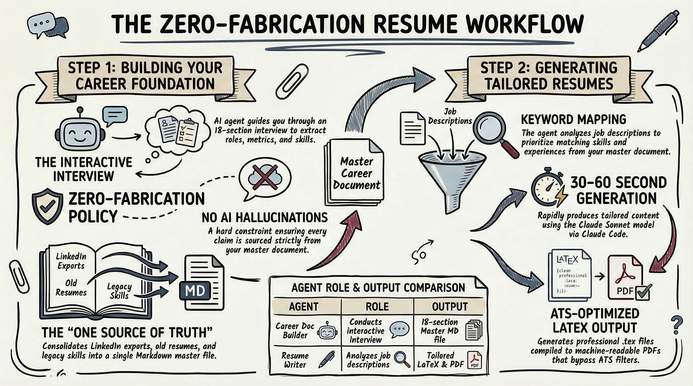
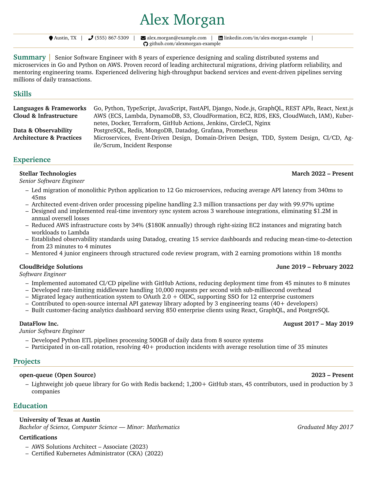
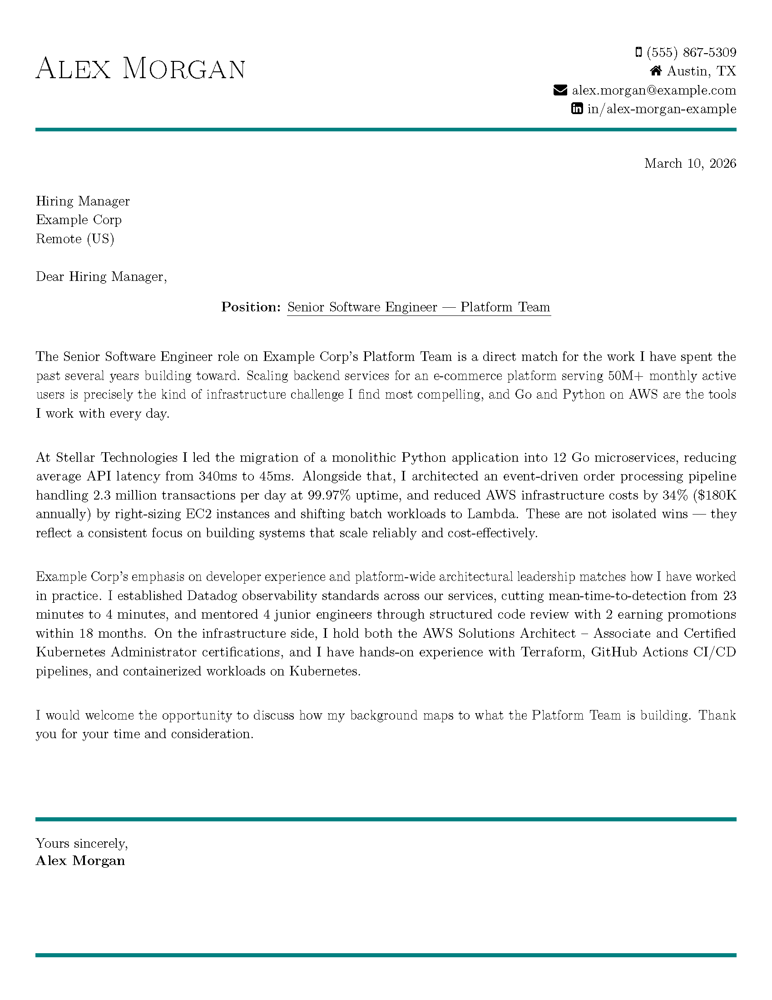

# ATS Resume Writer Agent for Claude Code

[](https://github.com/NullSpace-BitCradle/ats-resume-agent/actions/workflows/ci.yml)

> v1.3.2. Prefer the original? It is preserved as the [v1.1.0 release](https://github.com/NullSpace-BitCradle/ats-resume-agent/releases/tag/v1.1.0) and the [`v1` branch](https://github.com/NullSpace-BitCradle/ats-resume-agent/tree/v1). See [CHANGELOG.md](CHANGELOG.md) for what changed.

An AI-powered resume and cover letter generator built on [Claude Code](https://code.claude.com/docs). It creates ATS-optimized, LaTeX-formatted resumes tailored to specific job descriptions. It also includes a guided career document builder that helps you create the source material through an interactive interview.

**Zero fabrication policy:** The agent will never estimate metrics, suggest proxy numbers, or embellish your experience. If a quantified achievement isn't in your master document, it won't appear in the output. This is a hard constraint, not a suggestion, and a [validator](#verify-zero-fabrication) checks it in code.



## How It Works

The project has two agents that work together:

1. **Career Document Builder**: Guides you through an interactive interview to create a comprehensive Master Career Document. It can also ingest existing resumes, LinkedIn profile exports, or any career materials you already have as a starting point.
2. **Resume Writer**: Takes your Master Career Document and a job description, then produces a tailored LaTeX resume optimized for Applicant Tracking Systems. You run this each time you apply somewhere. With no job description, it writes a general resume aimed at the target titles in your MCD.

The typical flow:

1. Build your Master Career Document once (guided interview or manual)
2. Drop a job description file into the project
3. Tell Claude to generate a resume
4. The agent selects the most relevant content, maps keywords, and produces a polished PDF
5. The validator confirms every checked claim traces to your MCD, and an optional plain-text export gives you a copy for application forms

You can use it from a clone of this repository or install it as a [Claude Code plugin](#install-as-a-plugin).

### Sample Output

Here's what the agent produces from the included example data:

**Resume:**



**Cover Letter:**



## Prerequisites

### Claude Code

Install [Claude Code](https://code.claude.com/docs) (Anthropic's CLI tool). On macOS, Linux, or WSL:

```bash
curl -fsSL https://claude.ai/install.sh | bash
```

On Windows PowerShell:

```powershell
irm https://claude.ai/install.ps1 | iex
```

On Windows CMD, run `curl -fsSL https://claude.ai/install.cmd -o install.cmd && install.cmd && del install.cmd`. Homebrew (`brew install --cask claude-code`) and WinGet (`winget install Anthropic.ClaudeCode`) also work. Run `claude --version` afterward to confirm the install. See the [setup guide](https://code.claude.com/docs/en/setup) for other options.

You need a Claude Pro, Max, Team, or Enterprise plan, or an Anthropic Console (API) account. The free claude.ai plan does not include Claude Code. See [authentication](https://code.claude.com/docs/en/authentication) for details. Each resume generation typically uses the Sonnet model and takes 30-60 seconds. The career document builder interview takes longer depending on career complexity.

### LaTeX (for PDF compilation)

The agent outputs `.tex` files. To compile them to PDF, you need `pdflatex`.

**Ubuntu/Debian/WSL:**
```bash
sudo apt-get install texlive-latex-base texlive-fonts-recommended \
  texlive-fonts-extra texlive-latex-extra cm-super
```
This installs all required LaTeX packages. `cm-super` provides the scalable fonts the cover letter template needs; without it, `pdflatex` stops with `auto expansion is only possible with scalable fonts`.

**macOS:**
```bash
brew install --cask mactex-no-gui
```
The full `mactex-no-gui` (~4GB) includes all required packages. The smaller `basictex` (~100MB) may be missing fonts and packages. If you use it, install missing packages with `tlmgr`:
```bash
sudo tlmgr update --self
sudo tlmgr install fontawesome5 fontawesome CormorantGaramond charter \
  ragged2e microtype lastpage bookmark tabularx enumitem titlesec fancyhdr cm-super
```

**Windows (native, MiKTeX):**

[MiKTeX](https://miktex.org/download) is the usual native Windows LaTeX. Install it, then let it fetch packages in one of two ways:

- In MiKTeX Console, under Settings, set "Install missing packages on-the-fly" to **Always**. The first compile then downloads what it needs, which can take a few minutes. With the default ("Ask"), MiKTeX opens an install dialog in the middle of a compile, and a compile run by an agent waits on it and looks hung.
- Or install everything up front, from PowerShell or Git Bash:
  ```powershell
  miktex packages require fontawesome5 fontawesome cormorantgaramond charter ragged2e microtype lastpage bookmark latex-tools enumitem titlesec fancyhdr cm-super
  ```

The `sudo` and `tlmgr` commands elsewhere in this README don't apply to MiKTeX; its package names are mostly the same, but in lowercase (`cormorantgaramond`), and `tabularx` comes in `latex-tools`. If a compile still fails right after packages were installed, for example the cover letter with `auto expansion is only possible with scalable fonts`, run it once more before digging further: in testing, a second run passed with nothing else changed. TeX Live for Windows also works, and so does WSL with the Ubuntu instructions above. `./setup.sh` runs in Git Bash and knows about MiKTeX.

**Important:** The resume template uses `fontawesome5` and the cover letter template uses `fontawesome`. These are separate packages, and both must be installed for full functionality.

### Bun (for the validator and text export)

The [zero-fabrication validator](#verify-zero-fabrication), the [plain-text export](#plain-text-export), and the [document reader](#reading-old-resumes) run on [Bun](https://bun.com). Resume generation works without it, but nothing gets checked: the agent skips the validator and the export and says `VALIDATOR NOT RUN` in its final message. `./setup.sh` checks for Bun and offers to install it. On macOS, Linux, or WSL:

```bash
curl -fsSL https://bun.com/install | bash
```

See the [Bun installation docs](https://bun.com/docs/installation) for Windows and other options.

<details>
<summary>Troubleshooting LaTeX packages</summary>

To check if a specific package is installed:
```bash
kpsewhich fontawesome5.sty
```

If `pdflatex` fails with `File 'X.sty' not found`, install the missing package:
```bash
sudo tlmgr install <package-name>
```

On MiKTeX, use `miktex packages install <package-name>` or MiKTeX Console instead (no `sudo`).

If you don't have LaTeX installed and don't want to install it locally, you can still use the agent to generate the `.tex` files and compile them using [Overleaf](https://www.overleaf.com/) or another online LaTeX editor.
</details>

## Setup

There are two ways to use this project. Clone it (steps below) if you want to edit the templates or agents. Or install it as a Claude Code plugin and use it from any folder without cloning (see [Install as a plugin](#install-as-a-plugin)).

1. **Clone this repository:**
   ```bash
   git clone https://github.com/NullSpace-BitCradle/ats-resume-agent.git
   cd ats-resume-agent
   ```

2. **Check dependencies** (optional but recommended):
   ```bash
   ./setup.sh
   ```
   This checks for Claude Code, Bun, and LaTeX, and offers to install anything missing.

3. **Create your Master Career Document** (choose one):

   **Option A, guided interview (recommended):**
   ```
   Help me build my career document
   ```
   The `career-doc-builder` agent will walk you through an interactive interview to produce a comprehensive MCD of up to 19 sections. If you have existing resumes (Word, Pages, OpenDocument, RTF, PDF, or text), LinkedIn exports, or other career materials, it can ingest those as a starting point.

   **Option B, manual:**
   ```bash
   cp examples/Master_Career_Document.md Master_Career_Document.md
   ```
   Edit `Master_Career_Document.md` with your real career data. See the example file for the expected format and available features like agent notes and legacy sections.

   **Note:** `Master_Career_Document.md` and `Job_Description-*.md` files are gitignored by default to prevent accidentally committing personal information, and so are the `candidates/` and `inputs/` folders and any `.doc`, `.docx`, `.pages`, `.odt`, or `.rtf` file in the project root. The example files in `examples/` are tracked normally.

4. **Start Claude Code in the project directory:**
   ```bash
   claude
   ```

   The agent definition in `.claude/agents/ats-resume-writer.md` is preconfigured, so you don't need to read or modify it to generate resumes.

### Install as a plugin

This repository is also a Claude Code plugin marketplace. Inside any Claude Code session, run these, then confirm the install in the `/plugin` panel that the second command opens:

```
/plugin marketplace add NullSpace-BitCradle/ats-resume-agent
/plugin install ats-resume-agent@nullspace-bitcradle
```

Or from your shell, where the install finishes directly:

```bash
claude plugin marketplace add NullSpace-BitCradle/ats-resume-agent
claude plugin install ats-resume-agent@nullspace-bitcradle
```

That installs both agents (`ats-resume-writer` and `career-doc-builder`) along with the LaTeX templates and the validator. Then work from any folder that holds your `Master_Career_Document.md` and, for a tailored resume, a `Job_Description-*.md` file. Generated files go to `output/` in that folder (or in `candidates/<name>/output/`, see [Working on Someone Else's Behalf](#working-on-someone-elses-behalf)). You still need `pdflatex` for PDFs (see [Prerequisites](#latex-for-pdf-compilation)), and Bun for the validator, the text export, and reading old resumes.

To update later, run `/plugin marketplace update nullspace-bitcradle`.

## Usage

### Generate a Resume

Drop a job description file in the project root:

```bash
# Name it following the convention:
# Job_Description-[Company]-[Role].md
```

Then tell Claude:

```
Resume for the Example Corp file
```

or:

```
Resume and cover letter for the Example Corp file
```

The agent will:
1. Read your Master Career Document
2. Analyze the job description for keywords and requirements
3. Select the most relevant experience and skills
4. Generate a `.tex` file with ATS-optimized content
5. Compile it to PDF using `pdflatex`
6. Run the validator and fix any claim it flags (if Bun is installed; otherwise it says `VALIDATOR NOT RUN`)
7. Write a plain-text copy for application forms (if Bun is installed)

Output files are saved to the `output/` directory.

### Generate a General Resume

With no job description, ask for a general resume:

```
General resume from my career document
```

The agent aims it at the target titles in your MCD's "Professional Identity & Positioning" section, follows its "Notes for Resume Customization", and saves it as `output/Resume-[Name]-General.tex`. It's a good first resume after building an MCD, and a fallback for applications with no posting. Cover letters still need a job description.

### Working on Someone Else's Behalf

To build an MCD or a resume for a family member or a client, give them a folder of their own:

```
candidates/
  riley/
    Master_Career_Document.md
    Job_Description-Example_Clinic-Office_Manager.md
    output/
```

Name the candidate in the request ("general resume for riley", "build an MCD for riley from the files in inputs/") and both agents read and write only inside that folder. `candidates/` and `inputs/` (a place to drop their old resumes) are gitignored. The root-level files keep working as before for your own documents.

### Review and Iterate

After generating a resume, you can ask for adjustments:

```
Make the summary more focused on leadership experience
```

```
Add the CloudBridge SSO migration project to the experience section
```

```
Cut it to one page and lead with the platform work
```

### Verify Zero Fabrication

The zero-fabrication promise is checked in code, not just in the prompt. The validator reads a generated resume and your Master Career Document and fails if the resume contains anything the MCD does not back up:

- **Numbers:** every number, including spelled-out ones like "fifteen" or "12 million", must appear in the MCD. Percentages must match a percentage, money must match money in the same currency, and scaled values must match by value, so `2.3M`, `2.3 million`, and `2,300,000` are interchangeable, but a bare `3` does not back `3M`.
- **Dates:** each start and end date on a heading line. `Mar 2022`, `March 2022`, and `03/2022` count as the same date, and so do Present and Current.
- **Employers, titles, and degrees:** the text of every `\headingBf`, `\headingIt`, and `\heading` line, plus client names in `\itemTitle{Client: ...}`. When a heading has several parts (`Software Engineer, Mathematics`), they must all come from one section of the MCD, not from anywhere in it. Common degree abbreviations (`B.S.`, `MBA`, `Ph.D.`) match the spelled-out degree.
- **Certifications:** each item, and any loose text, under a Certifications, Licenses, or Credentials heading or section. The name, issuer, and year must appear together in one MCD bullet, so when each certification is its own bullet, a real certification with a shifted year still fails. An entry can run across several lines.
- **Skills:** each item in the skills table, including rows that wrap across lines. An acronym passes when the MCD spells out the phrase it stands for (`TDD` for Test-Driven Development), and `AWS (EC2, Lambda)` in the MCD backs `AWS Lambda`.

These never count as a source: the "Legacy & Historical Platforms" section at any heading level (and titles like "Legacy Skills", "Deprecated Skills", or plain "Legacy"), Agent Notes, whether a quoted block or a bullet (a note saying "never list CISSP" is not evidence of CISSP), HTML comments, link targets, and the table of contents. Neither do the sections that hold wishes and instructions rather than history: Professional Identity & Positioning (target titles are roles you want, not roles you held), Work Preferences, and Notes for Resume Customization (a note saying "leave out roles older than 15 years" is not 15 years of experience). The resume writer still reads them for direction; they just can't back a claim.

It also flags an unescaped `%` after a number (`34%` instead of `34\%`). LaTeX treats that `%` as the start of a comment, so the rest of the line silently disappears from the PDF even though `pdflatex` reports success.

It also checks the skills table's structure. Every row must end with `\\` and have exactly one unescaped `&`. When a `\\` is lost, two rows run together and the skills would otherwise come out as misleading merged tokens, so the validator reports the missing terminator as a `latex` finding on the row that lost it and still checks each row's skills on their own. An unescaped `&` in a category label is reported the same way.

If the resume has a skills section (Skills, Core Competencies, Technical Proficiencies, and similar names) or a certifications heading the validator cannot read, for example skills written as plain text instead of the template's table, it reports a `coverage` finding instead of passing. An unfamiliar layout fails loudly; it never passes silently.

The validator needs [Bun](#bun-for-the-validator-and-text-export):

```bash
bun tools/validate.ts output/Resume-Your_Name-Company-Role.tex Master_Career_Document.md
```

It prints `PASS` and exits 0, or lists each unsupported claim with its line number and exits 1. Files that don't end in `.tex` are read as plain text, and only their numbers are checked.

**Cover letters** can name the company, the role, and facts from the job posting, so pass the job description as an extra source:

```bash
bun tools/validate.ts output/CoverLetter-Your_Name-Company-Role.tex Master_Career_Document.md Job_Description-Company-Role.md
```

A number that only the job description backs has to keep its context: the letter's sentence must share a word with the posting's sentence. `serving 50M+ users` passes against "serving 50M+ monthly active users", but `mentored 5 junior engineers` does not pass just because the posting asks for "5+ years". Close paraphrases can still fail (`the 5-year requirement` shares no word with `5+ years`); reword or leave the number out.

The letter's own date is skipped when it sits on a line of its own that starts a paragraph (after a blank line, and followed by a blank line, a `\\` break, or the salutation), or after `\hfill` at the end of a line. A date inside a sentence is still checked, and resumes never skip dates.

The validator refuses extra sources for a file with resume structure. Everything on a resume has to come from your own history, and a job posting's tech stack is exactly where padded skills come from.

What it cannot prove:

- **It matches values, not sentences.** If a real number, title, or date shows up attached to the wrong role, the validator will not notice.
- **Parts of a heading can be combined within one MCD section.** Any parts found in the same section pass together, so two titles from one employer's history, or a title and a word from that role's bullets, can be joined into one heading.
- **A posting's metric can be claimed as your own** if the sentence shares words with the posting's sentence.
- **Shorthand like `45m` reads as 45 million.** Write out minutes.
- **Synonyms fail.** If the MCD says PostgreSQL and the resume says Postgres, it fails. The fix is to add the term to your MCD if it's true.
- **Prose isn't parsed for names.** An employer mentioned only in the summary paragraph isn't checked.
- **Only the skills table is checked.** Once the validator reads a skills table, skills written as plain text beside it, or named in a bullet, aren't checked. The `coverage` finding fires only when no table can be read at all.

Treat a PASS as "nothing was invented," not "every sentence is accurate," and still read the output.

### Plain-Text Export

Some applicant tracking systems read plain text more reliably than a PDF, and many application forms want resume text pasted into a box. The export turns a generated `.tex` into clean text with standard section headings, one line per role, and dash bullets:

```bash
bun tools/export-text.ts output/Resume-Your_Name-Company-Role.tex
```

It writes `output/Resume-Your_Name-Company-Role.txt` (pass a second argument to choose the path). It also handles cover letters. The header line keeps every contact item, plain-text ones such as the location included. The `.tex` stays the source of truth. The export is derived from it, so run the validator on the `.txt` too if you edit it by hand.

### Reading Old Resumes

Old resumes often come as Word, Pages, or OpenDocument files, which the agents can't read directly. The career document builder converts them first with `tools/ingest.ts`, and you can run it yourself:

```bash
bun tools/ingest.ts inputs/resume-2012.docx inputs/resume-2016.pages --out inputs/text
```

That writes `inputs/text/resume-2012.txt` and `inputs/text/resume-2016.txt`. Without `--out`, the text prints to the terminal. It reads:

- **`.docx`, `.odt`, `.rtf`** with its own parsers, no other software needed. Headers come first, since resumes often keep the name and contact line there.
- **`.pages`** best effort, also with no other software: it decodes the document's text from the file, which can carry stray style names. It also saves the image of page one (`<name>.preview.jpg`) so you can compare. The decoder was checked against real iWork files from a public test corpus, but not yet against a real Pages resume.
- **`.doc`** (Word 97-2003) through whatever converter is installed: LibreOffice (`soffice`), Microsoft Word on Windows, macOS `textutil`, `antiword`, or `catdoc`. On a Mac, `textutil` is built in, and on Windows an installed copy of Word does the job (opened hidden and read-only). Elsewhere, installing [LibreOffice](https://www.libreoffice.org/) is the simplest route. The same converters are a fallback when the built-in parsers can't read a file.
- **`.pdf`, `.md`, `.txt`** need no conversion; the agents read them directly.

When nothing can read a file, it says what it tried and asks you to export the document as a PDF from the app that made it, or paste the text.

### Build or Update Your Career Document

The `career-doc-builder` agent guides you through creating a comprehensive Master Career Document via interactive interview:

```
Help me build my career document
```

It can also enrich an existing MCD:

```
Review my career document for gaps
```

```
Update my MCD with my new role
```

Or compile one from someone's documents when they aren't there to interview:

```
Compile a career document for riley from the files in inputs/; they aren't here to answer questions
```

Compile mode writes facts from the documents only, in their wording: no suggested duties, no web search, no new summaries. Where documents disagree it uses the most recent one and lists the conflict; missing dates, missing contact details, and gaps go in an "Open questions" HTML comment at the top, which the validator ignores. The document is marked as compiled and unconfirmed, with an Agent Note telling the resume writer it holds nothing the sources lacked. Run the builder again with the candidate present and it starts from those open questions.

#### How the Career Document Builder Works

The agent runs a multi-phase interview that builds your career document section by section:

1. **Intake**: Feed it existing resumes, LinkedIn exports, or any career materials you have. It extracts roles, skills, metrics, and dates as a baseline. Starting from scratch is fine too.
2. **Identity & Positioning**: Establishes your target titles, value proposition, and writes 2-4 genuinely different professional summary angles.
3. **Skills Inventory**: Walks through the skill categories of your own field, whatever it is, suggests gaps, and separates current skills from legacy ones.
4. **Work Experience**: The core of the interview. Goes role by role (most recent first), probing for metrics, suggesting common responsibilities you may have missed, and offering agent notes where context matters. It asks once, gently, about any gap of more than 6 months, and records a career break only if you want one, with the reason in your words (see [Career Breaks](#career-breaks)).
5. **Supporting Sections**: Education, certifications and licenses, volunteer work, and positioning guidance, plus publications, project highlights, and compliance expertise only when your field has them.
6. **Synthesis**: Revises your summaries with the full career context, curates a highlight reel of your strongest metrics, and delivers the final document.

The output is a single Markdown file with up to 19 structured sections: 18, plus Legacy & Historical Platforms, with the three field-specific ones only when they apply. The interview typically takes 30-60 minutes depending on career complexity and how much existing material you provide. Once complete, you reuse this document every time you generate a resume, with no re-interviewing.

## Project Structure

```
ats-resume-agent/
|-- README.md                 # This file
|-- CHANGELOG.md              # Release notes
|-- CONTRIBUTING.md           # How to contribute
|-- LICENSE                   # MIT
|-- CLAUDE.md                 # Instructions for Claude Code (you don't need to edit this)
|-- setup.sh                  # Dependency checker and installer
|-- package.json              # Bun scripts: validate, export, test
|-- agents/                   # Same agents, in the plugin layout (kept identical by CI)
|-- .claude-plugin/
|   |-- plugin.json           # Plugin manifest (name, version, metadata)
|   `-- marketplace.json      # Lets /plugin marketplace add install from this repo
|-- .github/
|   |-- ISSUE_TEMPLATE/       # Bug report and LaTeX error forms
|   |-- scripts/version-bump.sh  # CI: shipped files changed since the last tag need a new plugin version
|   `-- workflows/ci.yml      # Tests, version check, LaTeX build, plugin install check
|-- .gitignore                # Excludes output files and personal documents
|-- .claude/
|   `-- agents/
|       |-- ats-resume-writer.md   # Resume/cover letter generation agent
|       `-- career-doc-builder.md  # Interactive career document builder agent
|-- images/                        # Screenshots for README
|-- tools/
|   |-- validate.ts                # Zero-fabrication validator
|   |-- latex.ts                   # Shared LaTeX parsing helpers
|   |-- export-text.ts             # Plain-text export for ATS portals
|   |-- ingest.ts                  # Old resumes (.docx, .doc, .odt, .rtf, .pages) to text
|   `-- *.test.ts                  # Tests (bun test)
|-- templates/
|   |-- resume-template.tex        # LaTeX resume template (CC-BY-4)
|   |-- LICENSE-CC-BY-4.0.md       # License notice for the resume template
|   `-- cover-letter-template.tex  # LaTeX cover letter template
|-- examples/
|   |-- Master_Career_Document.md  # Example career doc with fake data
|   |-- Job_Description-Example_Corp-Senior_Engineer.md  # Example JD
|   `-- sample-output/
|       |-- Resume-Alex_Morgan-Example_Corp-Senior_Engineer.tex  # Example generated resume
|       |-- CoverLetter-Alex_Morgan-Example_Corp-Senior_Engineer.tex  # Example cover letter
|       |-- resume-preview.pdf     # Blank resume template, rendered
|       `-- cover-letter-preview.pdf  # Blank cover letter template, rendered
|-- output/                        # Generated resumes go here (gitignored)
|-- candidates/                    # Optional: one folder per person you work for (gitignored)
`-- inputs/                        # Optional: old resumes to read (gitignored)
```

## Master Career Document Format

The `career-doc-builder` agent produces a comprehensive MCD of up to 19 sections (18, plus Legacy & Historical Platforms; publications, project highlights, and compliance expertise appear only when your field has them). You can also create one manually; the resume writer agent handles both formats. Key sections:

| Section | Purpose |
|---------|---------|
| **Contact Information** | Name, location, phone, email, LinkedIn, portfolio links |
| **Professional Identity & Positioning** | Target titles and core value proposition |
| **Professional Summaries** | 2-4 different summary angles for different role types |
| **Hybrid Strengths** | Cross-domain strengths (section name adapts to your field) |
| **Core Competencies & Technical Skills** | Categorized skill lists with sub-categories |
| **Industries Supported** | Industries served across your career |
| **Work Experience** | Detailed roles with metrics and agent notes |
| **Education & Training** | Degrees, courses, certifications, lab environments |
| **Key Achievements & Metrics** | Curated highlight reel of strongest outcomes |
| **Leadership & Soft Skills** | Leadership style, values, professional attributes |
| **Notes for Resume Customization** | Positioning angles and metrics guidance by role type |
| **Legacy & Historical Platforms** | Outdated skills to exclude from resumes |

See `examples/Master_Career_Document.md` for the full structure with all available sections.

### Career Breaks

Time away from work (caregiving, raising children, health, study, relocation) can be recorded as its own entry under Work Experience, in its place in the timeline:

```markdown
### Career Break -- Full-time study
**June 2014 -- December 2015**

- Completed an evening Spanish course

> **Agent Note:** Show this as its own entry; keep the reason as written.
```

The reason is yours to word, and the bullets (courses, volunteering) are optional. The resume writer shows it as its own entry (`\headingBf{Career Break}{dates}`, then the reason) and never invents an explanation for a gap the MCD doesn't record. The validator checks the heading and dates like any other role, so a break the MCD doesn't have fails.

How far back a resume goes is measured from the end of your most recent role, not from today, so a break doesn't push your earlier career off the page, and the writer never drops a role that would open a gap the MCD doesn't have. Your Notes for Resume Customization can override this.

### Agent Notes

You can embed instructions for the agent directly in your career document:

```markdown
> **Agent Note:** This project was collaborative; do not attribute sole ownership.
```

The agent treats these as binding instructions and will respect them when generating content.

### Legacy Section

Any content under a "Legacy & Historical Platforms" heading is automatically excluded from all generated resumes, and the validator never counts it as a source. Titles like "Legacy Skills" or "Deprecated Skills" work the same way. Use this for outdated skills you want to keep on record but never include in applications.

## Key Design Decisions

**LaTeX over Word/PDF:** LaTeX produces consistent, professional formatting and is ATS-compatible through Unicode glyph mapping (`\pdfgentounicode=1`). The PDF output is machine-readable by ATS systems despite custom fonts and styling.

**Keyword-first content selection:** The agent builds a keyword map from each job description and prioritizes matching content from your career document. Skills sections list job-description keywords first within each category.

**One source of truth:** All content comes from the Master Career Document. The agent never asks you for information during generation. It reads the files and produces output.

**Checked, not trusted:** The prompt tells the agent not to fabricate, and the validator checks that it didn't. CI runs the validator tests, builds every template and example with `pdflatex`, installs the plugin, and checks that a change to the agents, tools, or templates since the last release comes with a new plugin version, on every push.

## Customization

### Adjusting the Visual Design

The LaTeX templates in `templates/` control the visual design:

- **Colors:** Edit the `\definecolor` lines in `templates/resume-template.tex`
  ```latex
  \definecolor{accentTitle}{HTML}{0e6e55}  % Name and section text
  \definecolor{accentText}{HTML}{0e6e55}   % Section headings
  \definecolor{accentLine}{HTML}{a16f0b}   % Horizontal rules
  ```
- **Fonts:** Uncomment one of the sans-serif options or keep the default serif (Garamond + Charter)
- **Margins:** Adjust the `\addtolength` values
- **Bullet style:** Change `\renewcommand\labelitemi{--}` to use a different bullet character

### Adjusting Content Strategy

The agent's content selection strategy and quality standards are defined in the "The resume" section of `.claude/agents/ats-resume-writer.md`. You can modify these to match your preferences. For example, changing the recency window from 5-7 years to 10 years (it is measured from the end of the most recent role), or adjusting the page limit. If you plan to contribute the change, copy the file to `agents/` too; the plugin loads that copy, and CI checks the two match.

### Cover Letter Tone

Edit the "The cover letter" section of the agent definition to adjust tone, structure, or length preferences.

### Model Settings

Both agents default to Sonnet (`model: sonnet` in each agent file's frontmatter). You can pick a different model in any of these ways, from most specific to least:

- **Per request:** name the model when you ask, such as "use the ats-resume-writer agent on Opus for the Example Corp file." A model named in the request wins over the other two settings below.
- **Per agent:** change the `model:` line at the top of `.claude/agents/ats-resume-writer.md` or `.claude/agents/career-doc-builder.md`. It takes an alias (`sonnet`, `opus`, `haiku`), a full model ID, or `inherit` to use whatever model your main session runs.
- **For every subagent:** set `CLAUDE_CODE_SUBAGENT_MODEL` (for example, to `opus`) in your environment or in the `env` block of your Claude Code settings. It applies to agents with no `model:` line. Adding `CLAUDE_CODE_SUBAGENT_MODEL_FORCE=1` makes it win over everything: the `model:` lines are ignored, and a model named per request is too.

These work the same for a plugin install, whose agent files keep the `model: sonnet` line. With a plugin, though, the agent files live in Claude Code's plugin cache and are replaced on every update, so choose per request or with the environment variable rather than editing them. See [choosing a subagent's model](https://code.claude.com/docs/en/sub-agents).

#### How models compare on this workflow

On 2026-09-27, each model got the resume writer's instructions plus the example MCD and job description, with no sample output available to copy, and wrote the Example Corp resume. These runs skipped the agent's own validator step, so they measure what the model writes before any check; the validator scored each result afterward. Runs passing, across all batches:

| Model | Original prompt | Rewritten prompt |
|-------|--------------------------|------------------|
| Sonnet | 2 of 2 | 4 of 4 |
| Opus | 2 of 2 | 2 of 2 |
| Haiku | 1 of 4 | 4 of 4 |

With the original prompt, Haiku added Kafka, which appears only in the job description's tech stack, in 2 of 4 runs, and wrote `34%` instead of `34\%` (which silently cuts the rest of the line out of the PDF) in 2 of 4. The rewrite states that the job description never supplies content, puts a check on the skills table (where the padding happened), and requires escaping LaTeX special characters. Two further Haiku runs with the validator step turned on also passed, after fixing what it flagged.

"Original prompt" is v1.1.0 plus this release's plugin paths and validator steps, which these runs skipped. "Rewritten prompt" covers the rewrite and one round of small review edits (summary length, tense, certification form). The v1.3.0 additions that came later (the recency rule, career breaks, general resumes, candidate folders, and the location and compile instructions) were not part of these runs. On 2026-11-16, Sonnet ran the v1.3.0 agents with their validator steps on: a general resume for a nurse with a career break, the Example Corp resume and cover letter, and a compile-mode MCD from an old `.doc` and a `.txt` resume. Both resumes and the letter passed the validator. The compile run found that a reason the candidate gave in their own documents was being dropped, which v1.3.1 fixes. These are small samples, so treat them as a smoke test rather than a benchmark. Sonnet stays the default: Opus did no better on these checks and costs more. Either way, keep the validator step on.

If you find the agents occasionally deviating from instructions (adding unsolicited content, ignoring agent notes), start a fresh session to avoid context pollution from previous conversations. Running plain `claude` always starts a new session (only `--continue` or `--resume` pick up an old one), and `/clear` wipes the context inside a session that is already open.

## License

This project is licensed under the [MIT License](LICENSE).

The LaTeX resume template (`templates/resume-template.tex`) is adapted from [MTecknology/latex-resume](https://github.com/MTecknology/latex-resume) by [Michael Lustfield](https://github.com/mtecknology), modified for this project, and licensed under [CC-BY-4.0](https://creativecommons.org/licenses/by/4.0/legalcode.txt). See [templates/LICENSE-CC-BY-4.0.md](templates/LICENSE-CC-BY-4.0.md).

## Acknowledgments

- Resume LaTeX template adapted from [MTecknology/latex-resume](https://github.com/MTecknology/latex-resume) by [Michael Lustfield](https://github.com/mtecknology) (CC-BY-4.0)
- Built for use with [Claude Code](https://code.claude.com/docs) by Anthropic
